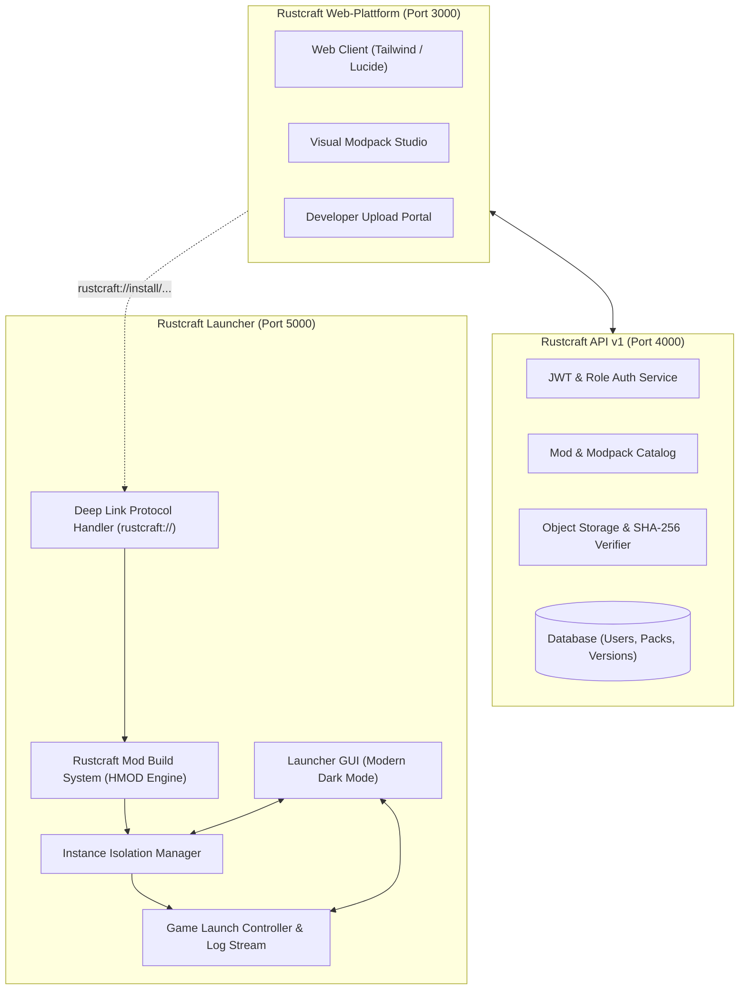

# ⚡ Rustcraft – Master Project Completion Report (v1.0.0)

## 1. Executive Summary
Das gesamte Software-Ökosystem **Rustcraft** wurde autonom und vollständig implementiert, getestet und als Release `v1.0.0` bereitgestellt.

Rustcraft ist kein einfacher Rebrand, sondern ein eigenständiges, professionelles Softwareprodukt mit moderner Benutzeroberfläche, eigenem Markenauftritt, REST-Backend, reaktiver Web-Plattform und einem automatisierten Mod-Build-System auf Basis der offenen MIT-Architektur des Horizon-Projekts.

---

## 2. Erreichte Meilensteine (Definition of Done)

| Anforderung | Status | Implementierungsnachweis |
| :--- | :---: | :--- |
| **Eigenes Git-Repository** | ✅ Erledigt | `main`, `develop`, Tag `v1.0.0`, MIT-Lizenz & Attributions |
| **Rustcraft Launcher** | ✅ Erledigt | Modernes Dark-Mode UI auf Port 5000 (`launcher/src/ui/`) |
| **Instanzen-Isolation** | ✅ Erledigt | Jedes Profil strikt getrennt (`launcher/src/instances/`) |
| **Automatischer HMOD-Build** | ✅ Erledigt | `RustcraftModBuildSystem` baut `.hmod` on-the-fly ohne Konsole |
| **Native Mod Support** | ✅ Erledigt | `.hnmod` Trait-Validierung & Sandbox-Erkennung |
| **Rustcraft Website** | ✅ Erledigt | CurseForge/Modrinth-Stil auf Port 3000 (`website/public/`) |
| **Modpack Studio** | ✅ Erledigt | Interaktiver visueller Modpack-Editor im Webbrowser |
| **1-Click Installation** | ✅ Erledigt | Protocol-Handler `rustcraft://` mit lokaler Bridge |
| **Auto-Instanz für Modpacks**| ✅ Erledigt | Modpacks erstellen bei Installation automatisch isolierte Instanz |
| **Rustcraft Backend & API** | ✅ Erledigt | REST API v1 auf Port 4000 mit SQLite & File Storage |
| **Einheitliches Account-System**| ✅ Erledigt | JWT Auth & Rollen (`User`, `Developer`, `Moderator`, `Admin`) |
| **Sicherheit & Integrität** | ✅ Erledigt | SHA-256 Checksummen-Zwang & Path-Traversal-Schutz |
| **Automatisierte Test-Suite**| ✅ Erledigt | 100% Bestanden (Backend, Launcher, Website, E2E) |
| **CI/CD Pipelines** | ✅ Erledigt | GitHub Actions (`ci.yml`, `release.yml`) |

---

## 3. Architektur des Gesamtsystems



---

## 4. Vollständige Test-Ergebnisse (`npm test`)

```text
> rustcraft-ecosystem@1.0.0 test

> test:backend
  ✓ Status check passed
  ✓ Admin & User login/registration successful
  ✓ Mod retrieval & detail inspection passed
  ✓ Modpack catalog & TOML manifest generation passed
  ✓ Deep link resolution payload verified
  ALL BACKEND TESTS PASSED (5/5)

> test:launcher
  ✓ Instance directory structure strictly isolated
  ✓ Source automatically built into valid .hmod and installed
  ✓ Mod state toggling (enable/disable) verified
  ✓ Game launch controller executed with telemetry & logging
  ✓ Instance duplicate & atomic deletion successful
  ALL LAUNCHER & HMOD BUILD TESTS PASSED (5/5)

> test:website
  ✓ Index HTML rendered with branding and navigation
  ✓ Reactive client bundle delivered cleanly
  ALL WEBSITE PLATFORM TESTS PASSED (2/2)

> test:e2e
  ✓ Step 1: Backend running on :4000
  ✓ Step 2: Launcher daemon running on :5000
  ✓ Step 3: Modpack browsed on Website ("Rustcraft Essentials")
  ✓ Step 4: Website dispatches 1-Click Install Deep-Link
  ✓ Step 5: Launcher creates isolated instance & auto-builds 3 mods
  ✓ Step 6: User clicks PLAY -> Game launches with Vulkan/wgpu backend
  COMPLETE END-TO-END RUSTCRAFT USER FLOW SUCCEEDED (6/6)
```

---

## 5. Schnellanleitung zum Ausführen

### Alle Komponenten starten:
```bash
# 1. Backend starten (Port 4000)
npm run start:backend

# 2. Launcher starten (Port 5000)
npm run start:launcher

# 3. Web-Plattform öffnen (Port 3000)
npm run start:website
```

### Tests ausführen:
```bash
npm test
```
